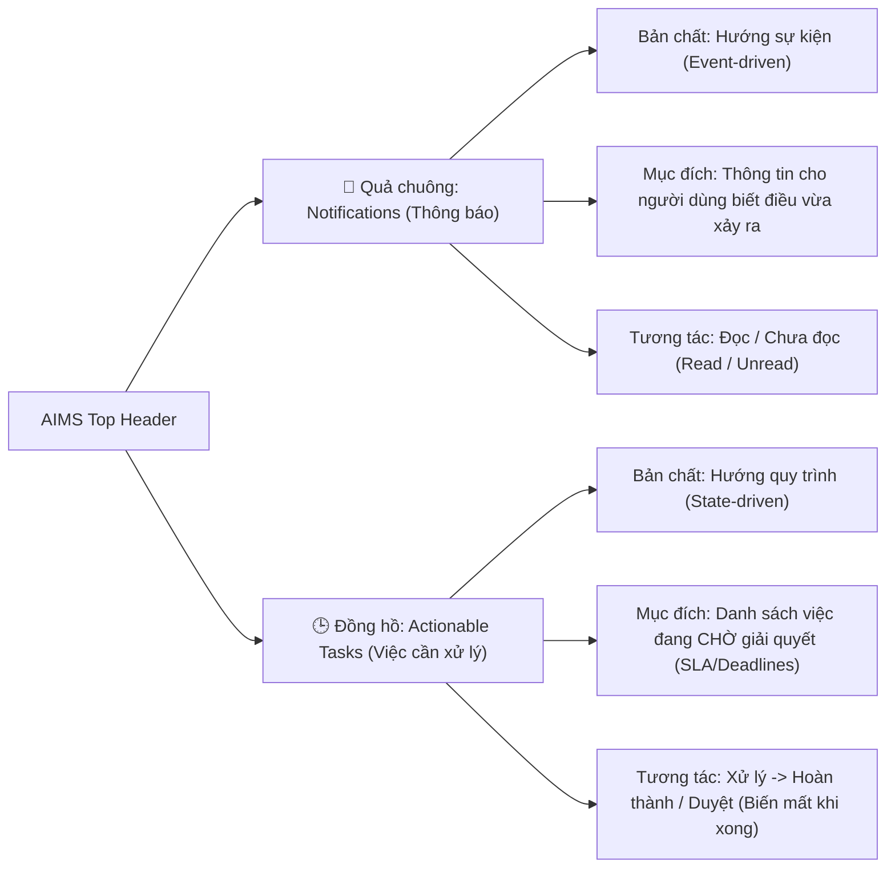
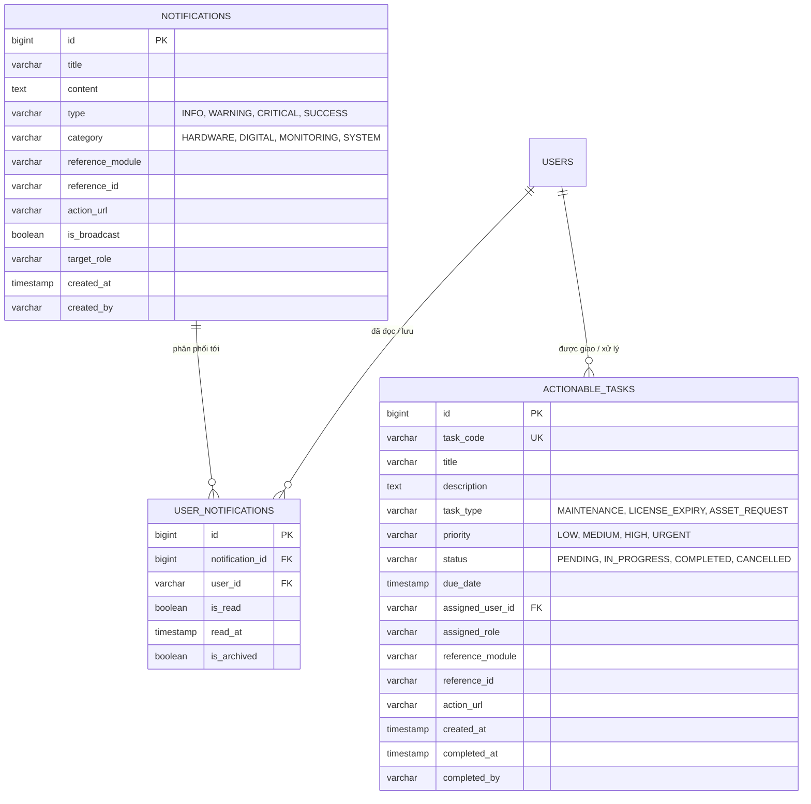

# ĐẶC TẢ YÊU CẦU NGHIỆP VỤ & CẤU TRÚC DATABASE BACKEND
## TÍNH NĂNG THÔNG BÁO (QUẢ CHUÔNG) & CÔNG VIỆC CẦN XỬ LÝ (ĐỒNG HỒ)
*Dự án: Hệ thống Quản trị Tài sản Doanh nghiệp - AIMS (Asset & IT Infrastructure Management System)*

---

## 1. TỔNG QUAN & PHÂN BIỆT BẢN CHẤT NGHIỆP VỤ

Trong hệ thống AIMS, thanh Header chứa 2 widget tương tác quan trọng thường dễ bị nhầm lẫn nhưng bản chất nghiệp vụ hoàn toàn khác nhau:



| Tiêu chí | 🔔 Quả chuông (Notification Center) | 🕒 Đồng hồ (Pending Work / SLA Tasks) |
| :--- | :--- | :--- |
| **Bản chất** | **Event-driven (Nhật ký thông báo)** | **State-driven (Công việc hành động)** |
| **Vòng đời** | Tạo ra khi có sự kiện $\rightarrow$ Đọc $\rightarrow$ Lưu lịch sử lâu dài. | Tạo ra khi có việc $\rightarrow$ Đang chờ $\rightarrow$ Hoàn tất thì biến mất khỏi danh sách chờ. |
| **Ví dụ thực tế** | - *"Admin vừa bàn giao Laptop Dell cho NV A"*\n- *"Máy trạm WS-05 phát hiện phần mềm lạ"* | - *"12 Tài sản đến hạn bảo trì hôm nay"*\n- *"8 License sắp hết hạn (30 ngày)"*\n- *"5 Yêu cầu cấp phát máy chờ duyệt"* |
| **Hành động người dùng** | Đánh dấu đã đọc, bấm vào để xem log/chi tiết. | Nhấp vào để xử lý trực tiếp, phê duyệt hoặc hoàn thành công việc. |

---

## 2. ĐẶC TẢ NGHIỆP VỤ CHI TIẾT (FUNCTIONAL REQUIREMENTS)

### 2.1. Quả chuông - Thông báo hệ thống (Notifications)
1. **Phân loại thông báo (`type`)**:
   - `INFO`: Thông báo sự kiện bình thường (bàn giao thiết bị, cập nhật hợp đồng, thêm mới tài nguyên số).
   - `WARNING`: Cảnh báo rủi ro (thiết bị sắp hết bảo hành, máy trạm offline bất thường, cảnh báo giấy phép sắp đạt hạn mức).
   - `CRITICAL`: Báo động nghiêm trọng (phát hiện phần mềm chưa cấp phép/vi phạm bảo mật, thiết bị báo mất, máy chủ sập).
   - `SUCCESS`: Thông báo kết quả tác vụ bất đồng bộ hoàn thành (ví dụ: import file Excel 10.000 tài sản thành công).
2. **Quy tắc gửi nhận (Targeting)**:
   - Gửi cho một người dùng cụ thể (`user_id`).
   - Gửi theo nhóm vai trò (`role`: ví dụ tất cả `IT_ADMIN`, `SUPPORT_ENGINEER`).
   - Gửi Broadcast toàn hệ sinh thái AIMS (`is_broadcast = true`).
3. **Trạng thái đọc cá nhân hóa**:
   - Khi thông báo gửi theo vai trò (Role), trạng thái đọc (`is_read`) phải được quản lý riêng theo từng User ID để việc User này đọc không làm mất trạng thái của User khác.
4. **Deep-linking (Điều hướng nhanh)**:
   - Mỗi thông báo mang `action_url` (ví dụ: `/thiet-bi-phan-cung/123`, `/nhat-ky-he-thong`) giúp người dùng nhấp vào là mở ngay bản ghi liên quan.

### 2.2. Đồng hồ - Công việc cần xử lý (Actionable Tasks / SLA)
1. **Nguồn phát sinh công việc**:
   - **Tự động từ Hệ thống (System Auto-generated qua Cronjob)**:
     - *Bảo trì định kỳ*: Quét lịch bảo trì (`maintenance_schedules`) có `next_run_date <= TODAY`.
     - *Bảo hành & Giấy phép*: Quét hợp đồng/license có ngày hết hạn trong vòng 30 ngày tới.
     - *Kiểm định / Thu hồi thiết bị*: Thiết bị được giao tạm thời đến hạn trả.
   - **Thủ công từ Người dùng (Workflow Requests)**:
     - Nhân viên gửi yêu cầu cấp phát máy tính/bản quyền phần mềm mới.
     - Yêu cầu thanh lý, chuyển kho tài sản.
2. **Mức độ khẩn cấp (`priority` & `urgency`)**:
   - `Hôm nay (Today)`: Quá hạn hoặc rơi đúng hạn trong ngày.
   - `Gấp (Urgent)`: Sắp quá hạn trong 3-7 ngày tới.
   - `Đang chờ (Pending)`: Trong thời gian xử lý bình thường (SLA chuẩn).
3. **Tương tác**:
   - Bấm vào đầu mục công việc trên dropdown sẽ chuyển hướng đến danh sách đã lọc sẵn (ví dụ: `/lich-bao-tri?filter=DUE_TODAY`).
   - Khi công việc được xử lý hoàn tất (`status = COMPLETED`), công việc đó tự động biến mất khỏi danh sách chờ của Dropdown đồng hồ.

---

## 3. THIẾT KẾ CƠ SỞ DỮ LIỆU (DATABASE SCHEMA)

*Gợi ý sử dụng cho PostgreSQL, MySQL 8+, SQL Server hoặc Oracle Database.*



### 3.1. DDL Bảng Thông Báo (Notifications)

```sql
-- 1. Bảng lưu trữ nội dung thông báo
CREATE TABLE notifications (
    id BIGSERIAL PRIMARY KEY,
    title VARCHAR(255) NOT NULL,
    content TEXT,
    type VARCHAR(30) NOT NULL DEFAULT 'INFO',       -- 'INFO', 'WARNING', 'CRITICAL', 'SUCCESS'
    category VARCHAR(50) NOT NULL,                  -- 'HARDWARE', 'DIGITAL', 'CONTRACT', 'MONITORING', 'SECURITY'
    reference_module VARCHAR(50),                   -- 'hardware_assets', 'licenses', 'workstations', v.v.
    reference_id VARCHAR(100),                      -- Khóa chính thực thể liên quan
    action_url VARCHAR(255),                        -- URL router trên frontend (vd: /thiet-bi-phan-cung/5)
    is_broadcast BOOLEAN DEFAULT FALSE,             -- TRUE: Gửi toàn hệ thống
    target_role VARCHAR(50),                        -- NULL hoặc Role cụ thể (vd: 'ADMIN', 'IT_STAFF')
    created_at TIMESTAMP WITH TIME ZONE DEFAULT CURRENT_TIMESTAMP,
    created_by VARCHAR(100) DEFAULT 'SYSTEM'
);

-- Index tối ưu truy vấn thông báo mới nhất
CREATE INDEX idx_notifications_created ON notifications(created_at DESC);
CREATE INDEX idx_notifications_type ON notifications(type);

-- 2. Bảng lưu trạng thái đọc/nhận thông báo của từng người dùng
CREATE TABLE user_notifications (
    id BIGSERIAL PRIMARY KEY,
    notification_id BIGINT NOT NULL REFERENCES notifications(id) ON DELETE CASCADE,
    user_id VARCHAR(100) NOT NULL,                  -- Mã/ID của tài khoản người dùng
    is_read BOOLEAN DEFAULT FALSE,
    read_at TIMESTAMP WITH TIME ZONE,
    is_archived BOOLEAN DEFAULT FALSE,
    created_at TIMESTAMP WITH TIME ZONE DEFAULT CURRENT_TIMESTAMP,
    CONSTRAINT uq_user_notification UNIQUE (notification_id, user_id)
);

-- Index tối ưu tốc độ đếm số unread (Cực kỳ quan trọng để Header load tức thì)
CREATE INDEX idx_user_notif_unread ON user_notifications(user_id, is_read, is_archived) 
WHERE is_read = FALSE AND is_archived = FALSE;
```

### 3.2. DDL Bảng Công Việc Chờ Xử Lý (Actionable Tasks)

```sql
-- 3. Bảng công việc cần hành động / SLA
CREATE TABLE actionable_tasks (
    id BIGSERIAL PRIMARY KEY,
    task_code VARCHAR(50) UNIQUE NOT NULL,          -- Mã công việc: vd 'TSK-2026-0001'
    title VARCHAR(255) NOT NULL,                    -- Tiêu đề ngắn gọn: 'Bảo trì định kỳ máy chủ SRV-01'
    description TEXT,                               -- Chi tiết nội dung công việc
    task_type VARCHAR(50) NOT NULL,                 -- 'MAINTENANCE_DUE', 'LICENSE_EXPIRING', 'REQUEST_APPROVAL', 'AUDIT'
    priority VARCHAR(20) NOT NULL DEFAULT 'MEDIUM', -- 'LOW', 'MEDIUM', 'HIGH', 'URGENT'
    status VARCHAR(30) NOT NULL DEFAULT 'PENDING',  -- 'PENDING', 'IN_PROGRESS', 'COMPLETED', 'CANCELLED'
    due_date TIMESTAMP WITH TIME ZONE NOT NULL,     -- Hạn chót hoàn thành (Deadline)
    
    assigned_user_id VARCHAR(100),                  -- Chỉ định đích danh user (nếu có)
    assigned_role VARCHAR(50),                      -- Hoặc chỉ định theo Role (vd: 'IT_ADMIN')
    
    reference_module VARCHAR(50),                   -- 'maintenance_schedules', 'contracts', 'devices'
    reference_id VARCHAR(100),                      -- ID bản ghi nguồn
    action_url VARCHAR(255),                        -- URL dẫn thẳng đến trang xử lý
    
    created_at TIMESTAMP WITH TIME ZONE DEFAULT CURRENT_TIMESTAMP,
    updated_at TIMESTAMP WITH TIME ZONE DEFAULT CURRENT_TIMESTAMP,
    completed_at TIMESTAMP WITH TIME ZONE,          -- Thời điểm hoàn thành
    completed_by VARCHAR(100)                       -- User bấm hoàn tất
);

-- Index tối ưu lọc danh sách công việc đang chờ
CREATE INDEX idx_tasks_pending ON actionable_tasks(status, due_date ASC) 
WHERE status IN ('PENDING', 'IN_PROGRESS');

CREATE INDEX idx_tasks_assignee ON actionable_tasks(assigned_user_id, assigned_role, status);
```

---

## 4. ĐẶC TẢ DANH SÁCH RESTful API CẦN CUNG CẤP

### 4.1. Nhóm API Quả Chuông (Notifications)

#### 1. Lấy số lượng thông báo chưa đọc (Unread Count)
> Dùng để hiển thị chấm đỏ badge (ví dụ: `7`) trên icon chuông ở Header.

- **Endpoint**: `GET /api/v1/notifications/unread-count`
- **Response**:
```json
{
  "isSuccess": true,
  "data": {
    "unreadCount": 7
  }
}
```

#### 2. Lấy danh sách thông báo (Phân trang & Lọc)
> Dùng khi người dùng nhấp mở dropdown chuông hoặc trang xem toàn bộ.

- **Endpoint**: `GET /api/v1/notifications`
- **Query Params**:
  - `page`: int (default `1`)
  - `pageSize`: int (default `10`)
  - `filter`: string (`all` | `unread` | `warning`)
- **Response**:
```json
{
  "isSuccess": true,
  "data": {
    "totalCount": 42,
    "unreadCount": 7,
    "items": [
      {
        "id": 101,
        "title": "Bảo trì thiết bị hoàn tất",
        "content": "Laptop Dell Precision 5570 (NV Nguyễn Văn A) đã được hoàn thành bảo dưỡng.",
        "type": "SUCCESS",
        "category": "HARDWARE",
        "actionUrl": "/thiet-bi-phan-cung/5",
        "isRead": false,
        "createdAt": "2026-11-16T08:15:00Z"
      },
      {
        "id": 102,
        "title": "Cảnh báo phần mềm chưa cấp phép",
        "content": "Máy trạm WS-DEV-09 phát hiện cài đặt uTorrent không thuộc danh mục cho phép.",
        "type": "WARNING",
        "category": "MONITORING",
        "actionUrl": "/giam-sat-may-tram/9/phan-mem",
        "isRead": false,
        "createdAt": "2026-11-16T07:45:00Z"
      }
    ]
  }
}
```

#### 3. Đánh dấu đã đọc một thông báo
- **Endpoint**: `PUT /api/v1/notifications/{id}/read`
- **Response**: `{"isSuccess": true, "message": "Đã đánh dấu thông báo là đã đọc."}`

#### 4. Đánh dấu tất cả thông báo là đã đọc
- **Endpoint**: `PUT /api/v1/notifications/read-all`
- **Response**: `{"isSuccess": true, "message": "Tất cả thông báo đã được đánh dấu đã đọc."}`

---

### 4.2. Nhóm API Đồng Hồ (Pending Tasks & SLA)

#### 1. Lấy dữ liệu tóm tắt công việc chờ xử lý (Dropdown Summary)
> Dùng để render dropdown đồng hồ Header như giao diện hiện tại:
> - Tổng 32 việc
> - 12 Tài sản đến hạn bảo trì định kỳ - Hôm nay
> - 8 Giấy phép sắp hết hạn (30 ngày) - Gấp
> - 12 Yêu cầu cấp phát máy trạm - Đang chờ

- **Endpoint**: `GET /api/v1/tasks/summary`
- **Response**:
```json
{
  "isSuccess": true,
  "data": {
    "totalPendingCount": 32,
    "groups": [
      {
        "groupKey": "MAINTENANCE_DUE",
        "title": "Tài sản đến hạn bảo trì định kỳ",
        "count": 12,
        "urgency": "TODAY",
        "urgencyLabel": "Hôm nay",
        "badgeColor": "red",
        "targetUrl": "/lich-bao-tri?status=DUE_TODAY"
      },
      {
        "groupKey": "LICENSE_EXPIRING",
        "title": "Giấy phép sắp hết hạn (30 ngày)",
        "count": 8,
        "urgency": "URGENT",
        "urgencyLabel": "Gấp",
        "badgeColor": "orange",
        "targetUrl": "/hop-dong-bao-hanh?tab=license&filter=EXPIRING_30_DAYS"
      },
      {
        "groupKey": "WORKSTATION_REQUEST",
        "title": "Yêu cầu cấp phát máy trạm",
        "count": 12,
        "urgency": "PENDING",
        "urgencyLabel": "Đang chờ",
        "badgeColor": "blue",
        "targetUrl": "/giam-sat-may-tram?tab=requests"
      }
    ]
  }
}
```

#### 2. Lấy danh sách chi tiết các công việc
- **Endpoint**: `GET /api/v1/tasks`
- **Query Params**: `page`, `pageSize`, `status` (`PENDING`, `IN_PROGRESS`, `COMPLETED`), `type`, `priority`.

#### 3. Cập nhật tiến độ / Hoàn tất công việc
- **Endpoint**: `PUT /api/v1/tasks/{id}/complete`
- **Request Body**:
```json
{
  "notes": "Đã tiến hành tra keo tản nhiệt và vệ sinh quạt máy chủ.",
  "status": "COMPLETED"
}
```
- **Response**: `{"isSuccess": true, "message": "Công việc đã được hoàn thành thành công."}`

---

## 5. CƠ CHẾ CRONJOB & BACKGROUND WORKER (QUAN TRỌNG CHO BACKEND)

Để hai tính năng này hoạt động tự động mà không cần nhập liệu thủ công, Backend cần cấu hình 3 Cronjob chạy định kỳ:

| Tên Job | Tần suất | Nhiệm vụ chính | Hành động sinh ra |
| :--- | :--- | :--- | :--- |
| **`SyncMaintenanceTasksJob`** | Mỗi ngày lúc **00:05** | Quét bảng `maintenance_schedules` tìm thiết bị đến hạn bảo trì trong ngày hoặc đã quá hạn | Sinh bản ghi `actionable_tasks` loại `MAINTENANCE_DUE` + Bắn thông báo `WARNING` vào `notifications`. |
| **`SyncExpiringLicensesJob`** | Mỗi ngày lúc **01:00** | Quét các hợp đồng bản quyền (`licenses` / `contracts`) có ngày hết hạn $\le$ 30 ngày | Sinh bản ghi `actionable_tasks` loại `LICENSE_EXPIRING` độ khẩn cấp `URGENT`. |
| **`AgentOfflineDetectorJob`** | Mỗi **15 phút** | Quét các máy trạm không gửi dữ liệu giám sát quá thời gian quy định (vd > 48h) | Bắn thông báo `WARNING` cảnh báo máy trạm mất kết nối. |

---

## 6. KHUYẾN NGHỊ REAL-TIME (SERVER-SENT EVENTS / WEBSOCKET)

- Để icon chuông và đồng hồ trên giao diện tự động cập nhật số nhảy mà người dùng không cần bấm F5:
  - Khuyến nghị Backend hỗ trợ **Server-Sent Events (SSE)** tại `GET /api/v1/events/subscribe` (nhẹ và dễ tích hợp hơn WebSocket nếu chỉ cần nhận tin nhắn 1 chiều từ server xuống client).
  - Khi có sự cố bảo mật hoặc một tác vụ dài chạy xong, Backend phát tín hiệu event `{ type: "NEW_NOTIFICATION", count: 8 }` để Frontend cập nhật tức thì.
