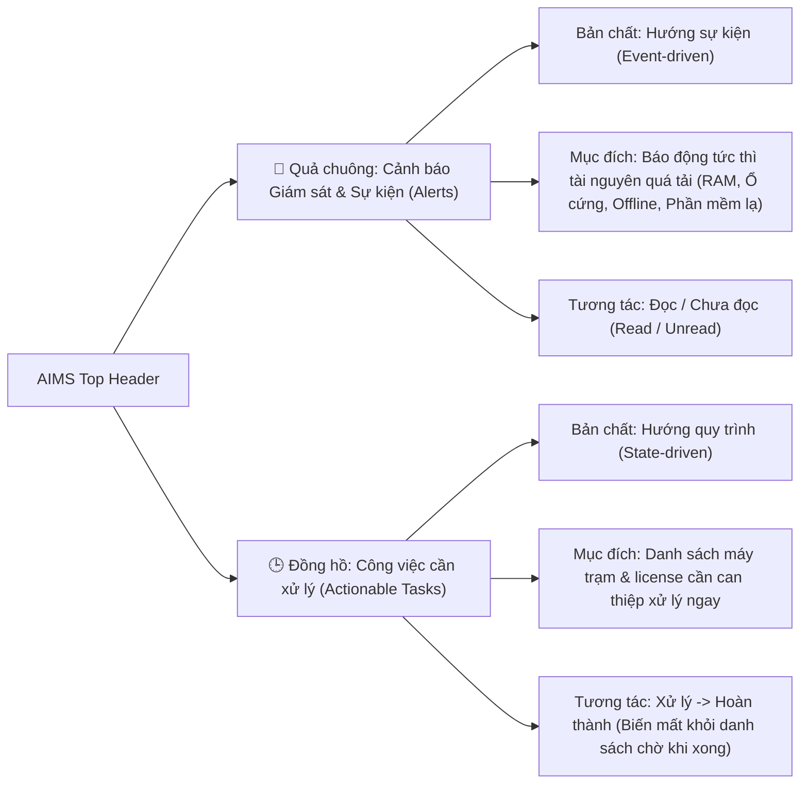
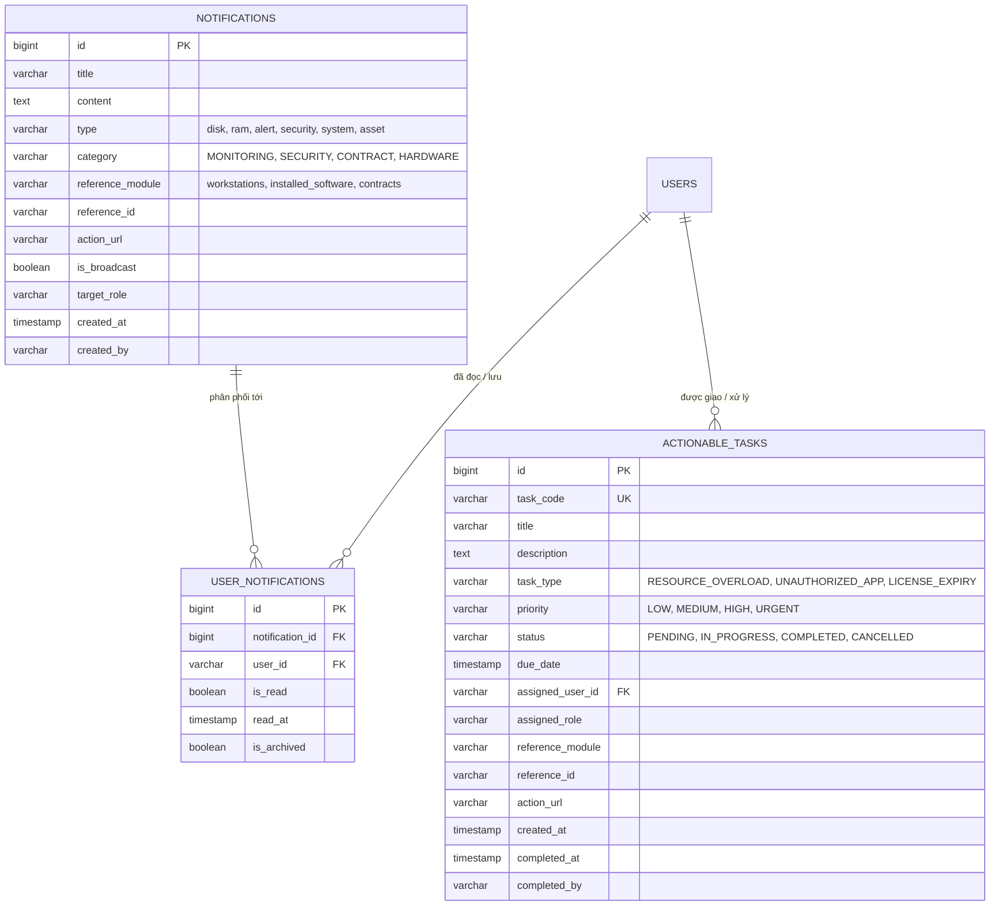

# ĐẶC TẢ YÊU CẦU NGHIỆP VỤ & CẤU TRÚC DATABASE BACKEND
## TÍNH NĂNG THÔNG BÁO (QUẢ CHUÔNG) & CÔNG VIỆC CẦN XỬ LÝ (ĐỒNG HỒ)
*Dự án: Hệ thống Quản trị Tài sản Doanh nghiệp - AIMS (Asset & IT Infrastructure Management System)*

---

## 1. TỔNG QUAN & ĐỊNH HƯỚNG NGHIỆP VỤ THỰC TẾ

Trong hệ thống AIMS, module **Giám sát máy trạm** (`/giam-sat-may-tram`) đã thu thập dữ liệu Telemetry trực tiếp từ thiết bị (RAM, Ổ cứng, CPU, Trạng thái Online/Offline, Phần mềm cài đặt). Do đó, thanh Header được chuẩn hóa nghiệp vụ theo đúng luồng thực tế của hệ thống:



| Tiêu chí | 🔔 Quả chuông (Alerts & Notifications) | 🕒 Đồng hồ (Actionable Tasks / SLA) |
| :--- | :--- | :--- |
| **Bản chất** | **Event-driven (Cảnh báo sự kiện tức thời)** | **State-driven (Công việc cần can thiệp)** |
| **Vòng đời** | Phát sinh khi vượt ngưỡng $\rightarrow$ Người dùng xem/đọc $\rightarrow$ Lưu lịch sử. | Phát sinh khi có sự cố $\rightarrow$ Đang chờ IT xử lý $\rightarrow$ Hoàn tất thì biến mất khỏi danh sách chờ. |
| **Nghiệp vụ thực tế** | - 🔴 *Ổ cứng C: máy WS-DESIGN-03 sắp đầy (chỉ còn 3.8 GB - 96%)*\n- 🔴 *RAM máy chủ SRV-01 vượt 95% liên tục 20 phút*\n- 🟠 *Phát hiện phần mềm chưa cấp phép (uTorrent)*\n- 🟠 *Máy trạm WS-ACC-05 mất tín hiệu Agent > 48h* | - 🔴 *5 Máy trạm quá tải tài nguyên (RAM/Ổ cứng) cần dọn dẹp*\n- 🟠 *3 Máy trạm có phần mềm lạ cần gỡ bỏ*\n- 🔵 *8 Giấy phép phần mềm sắp hết hạn (30 ngày)* |
| **Hành động người dùng** | Nhấp vào để xem chi tiết thông báo, nhảy tới máy trạm bị lỗi. | Nhấp vào để xử lý dọn dẹp ổ đĩa, gỡ phần mềm hoặc duyệt gia hạn bản quyền. |

---

## 2. ĐẶC TẢ NGHIỆP VỤ CHI TIẾT

### 2.1. Quả chuông - Cảnh báo giám sát & Thông báo (Notifications / Alerts)
Tập trung vào cảnh báo tài nguyên máy trạm và bảo mật ứng dụng:

1. **Cảnh báo dung lượng ổ cứng (Disk Space Alert)**:
   - `DISK_WARNING`: Ổ C: dung lượng trống $\le$ 15% (hoặc $\le$ 10 GB).
   - `DISK_CRITICAL`: Ổ C: dung lượng trống $\le$ 5% (hoặc $\le$ 3 GB) $\rightarrow$ Nguy cơ treo máy, không lưu được file.
2. **Cảnh báo bộ nhớ RAM (Memory Usage Alert)**:
   - `RAM_CRITICAL`: Mức sử dụng RAM $\ge$ 90% kéo dài liên tục trên 15 phút.
3. **Cảnh báo trạng thái kết nối Agent (Agent Offline Alert)**:
   - `AGENT_OFFLINE`: Máy trạm không gửi dữ liệu Telemetry về hệ thống quá 24h (hoặc 48h).
4. **Cảnh báo phần mềm chưa được cấp phép (Security Compliance Alert)**:
   - `UNAUTHORIZED_SOFTWARE`: Phát hiện phần mềm mới cài đặt không nằm trong danh mục White-list (ví dụ: game, phần mềm download torrent, tool bẻ khóa...).
5. **Thông báo khôi phục (Recovery)**:
   - Khi tài nguyên hạ nhiệt về mức an toàn (CPU/RAM giảm dưới ngưỡng), hệ thống thông báo trạng thái đã ổn định.

### 2.2. Đồng hồ - Công việc cần xử lý (Actionable Tasks)
Danh sách các đầu việc đang chờ IT can thiệp trực tiếp (không phụ thuộc vào bảng bảo trì):

1. **Nhóm 1: Máy trạm quá tải tài nguyên (Hôm nay / Đỏ)**:
   - Các máy trạm có ổ C: gần cạn kiệt hoặc RAM luôn ở ngưỡng đỉnh $\rightarrow$ Cần IT vào dọn dẹp file tạm, gỡ ứng dụng rác hoặc nâng cấp phần cứng.
   - *Đường dẫn điều hướng*: `/giam-sat-may-tram`.
2. **Nhóm 2: Phần mềm lạ cần kiểm tra & gỡ bỏ (Gấp / Cam)**:
   - Các máy trạm phát hiện phần mềm lạ $\rightarrow$ Cần IT xác minh với nhân viên và gửi lệnh hoặc can thiệp gỡ bỏ.
   - *Đường dẫn điều hướng*: `/giam-sat-may-tram/phan-mem`.
3. **Nhóm 3: Giấy phép / License phần mềm sắp hết hạn (Đang chờ / Xanh)**:
   - Các bản quyền phần mềm (Office 365, Antivirus, Cloud Server) còn hạn dưới 30 ngày $\rightarrow$ Cần kế toán/IT duyệt mua gia hạn.
   - *Đường dẫn điều hướng*: `/hop-dong-bao-hanh`.

---

## 3. THIẾT KẾ CƠ SỞ DỮ LIỆU (DATABASE SCHEMA)



### 3.1. DDL Bảng Thông Báo & Cảnh Báo (Notifications)

```sql
-- 1. Bảng lưu trữ thông báo & cảnh báo
CREATE TABLE notifications (
    id BIGSERIAL PRIMARY KEY,
    title VARCHAR(255) NOT NULL,
    content TEXT NOT NULL,
    type VARCHAR(30) NOT NULL DEFAULT 'alert',      -- 'disk', 'ram', 'alert', 'security', 'system', 'asset'
    category VARCHAR(50) NOT NULL,                  -- 'MONITORING', 'SECURITY', 'CONTRACT', 'HARDWARE'
    reference_module VARCHAR(50),                   -- 'workstations', 'installed_software', 'contracts'
    reference_id VARCHAR(100),                      -- ID bản ghi nguồn (vd: workstation_id)
    action_url VARCHAR(255),                        -- URL frontend (vd: /giam-sat-may-tram, /giam-sat-may-tram/9/phan-mem)
    is_broadcast BOOLEAN DEFAULT FALSE,             -- TRUE: Tất cả quản trị viên đều thấy
    target_role VARCHAR(50),                        -- NULL hoặc 'ADMIN', 'IT_STAFF'
    created_at TIMESTAMP WITH TIME ZONE DEFAULT CURRENT_TIMESTAMP,
    created_by VARCHAR(100) DEFAULT 'TELEMETRY_ENGINE'
);

CREATE INDEX idx_notifications_created ON notifications(created_at DESC);
CREATE INDEX idx_notifications_type ON notifications(type);

-- 2. Bảng quản lý trạng thái đọc cá nhân hóa từng User
CREATE TABLE user_notifications (
    id BIGSERIAL PRIMARY KEY,
    notification_id BIGINT NOT NULL REFERENCES notifications(id) ON DELETE CASCADE,
    user_id VARCHAR(100) NOT NULL,
    is_read BOOLEAN DEFAULT FALSE,
    read_at TIMESTAMP WITH TIME ZONE,
    is_archived BOOLEAN DEFAULT FALSE,
    created_at TIMESTAMP WITH TIME ZONE DEFAULT CURRENT_TIMESTAMP,
    CONSTRAINT uq_user_notification UNIQUE (notification_id, user_id)
);

CREATE INDEX idx_user_notif_unread ON user_notifications(user_id, is_read, is_archived) 
WHERE is_read = FALSE AND is_archived = FALSE;
```

### 3.2. DDL Bảng Công Việc Chờ Xử Lý (Actionable Tasks)

```sql
-- 3. Bảng công việc cần hành động
CREATE TABLE actionable_tasks (
    id BIGSERIAL PRIMARY KEY,
    task_code VARCHAR(50) UNIQUE NOT NULL,          -- Mã: 'TSK-2026-0001'
    title VARCHAR(255) NOT NULL,                    -- 'Xử lý ổ đĩa C: sắp đầy máy WS-DESIGN-03'
    description TEXT,                               -- Chi tiết vấn đề cần IT can thiệp
    task_type VARCHAR(50) NOT NULL,                 -- 'RESOURCE_OVERLOAD', 'UNAUTHORIZED_APP', 'LICENSE_EXPIRY'
    priority VARCHAR(20) NOT NULL DEFAULT 'MEDIUM', -- 'LOW', 'MEDIUM', 'HIGH', 'URGENT'
    status VARCHAR(30) NOT NULL DEFAULT 'PENDING',  -- 'PENDING', 'IN_PROGRESS', 'COMPLETED', 'CANCELLED'
    due_date TIMESTAMP WITH TIME ZONE NOT NULL,     -- Deadline xử lý
    
    assigned_user_id VARCHAR(100),                  -- Gán đích danh hoặc theo Role
    assigned_role VARCHAR(50),                      -- 'IT_ADMIN', 'SUPPORT_ENGINEER'
    
    reference_module VARCHAR(50),                   -- 'workstations', 'installed_software'
    reference_id VARCHAR(100),
    action_url VARCHAR(255),                        -- URL dẫn thẳng đến trang xử lý
    
    created_at TIMESTAMP WITH TIME ZONE DEFAULT CURRENT_TIMESTAMP,
    updated_at TIMESTAMP WITH TIME ZONE DEFAULT CURRENT_TIMESTAMP,
    completed_at TIMESTAMP WITH TIME ZONE,
    completed_by VARCHAR(100)
);

CREATE INDEX idx_tasks_pending ON actionable_tasks(status, due_date ASC) 
WHERE status IN ('PENDING', 'IN_PROGRESS');
```

---

## 4. ĐẶC TẢ DANH SÁCH RESTful API CẦN CUNG CẤP

### 4.1. Nhóm API Quả Chuông (Notifications)

#### 1. Lấy số lượng thông báo chưa đọc
- **Endpoint**: `GET /api/v1/notifications/unread-count`
- **Response**:
```json
{
  "isSuccess": true,
  "data": {
    "unreadCount": 3
  }
}
```

#### 2. Lấy danh sách thông báo (Phân trang & Lọc)
- **Endpoint**: `GET /api/v1/notifications`
- **Query Params**: `page=1&pageSize=10&filter=all|unread|alert`
- **Response**:
```json
{
  "isSuccess": true,
  "data": {
    "totalCount": 18,
    "unreadCount": 3,
    "items": [
      {
        "id": 101,
        "title": "Cảnh báo ổ cứng sắp đầy (96%)",
        "content": "Máy trạm [WS-DESIGN-03] - Ổ C: chỉ còn 3.8 GB trống / 128 GB. Cần dọn dẹp gấp để tránh treo máy.",
        "type": "disk",
        "category": "MONITORING",
        "actionUrl": "/giam-sat-may-tram",
        "isRead": false,
        "createdAt": "2026-11-21T08:15:00Z"
      },
      {
        "id": 102,
        "title": "Cảnh báo RAM quá tải (>90%)",
        "content": "Máy chủ [SRV-APP-PROD] sử dụng 15.2 / 16 GB RAM (95%) duy trì liên tục trên 20 phút.",
        "type": "ram",
        "category": "MONITORING",
        "actionUrl": "/giam-sat-may-tram",
        "isRead": false,
        "createdAt": "2026-11-21T08:00:00Z"
      },
      {
        "id": 103,
        "title": "Phát hiện phần mềm chưa cấp phép",
        "content": "Máy trạm [WS-DEV-09] vừa cài đặt phần mềm lạ (uTorrent Client) không thuộc danh mục cho phép.",
        "type": "security",
        "category": "SECURITY",
        "actionUrl": "/giam-sat-may-tram/phan-mem",
        "isRead": false,
        "createdAt": "2026-11-21T07:30:00Z"
      }
    ]
  }
}
```

#### 3. Đánh dấu đã đọc một thông báo
- **Endpoint**: `PUT /api/v1/notifications/{id}/read`
- **Response**: `{"isSuccess": true, "message": "Đã đánh dấu thông báo là đã đọc."}`

#### 4. Đánh dấu tất cả thông báo là đã đọc
- **Endpoint**: `PUT /api/v1/notifications/read-all`
- **Response**: `{"isSuccess": true, "message": "Tất cả thông báo đã được đánh dấu đã đọc."}`

---

### 4.2. Nhóm API Đồng Hồ (Pending Tasks & SLA)

#### 1. Lấy dữ liệu tóm tắt công việc chờ xử lý (Dropdown Summary)
- **Endpoint**: `GET /api/v1/tasks/summary`
- **Response**:
```json
{
  "isSuccess": true,
  "data": {
    "totalPendingCount": 16,
    "groups": [
      {
        "groupKey": "RESOURCE_OVERLOAD",
        "title": "Máy trạm quá tải tài nguyên (RAM/Ổ cứng)",
        "count": 5,
        "urgency": "TODAY",
        "urgencyLabel": "Hôm nay",
        "badgeColor": "red",
        "targetUrl": "/giam-sat-may-tram"
      },
      {
        "groupKey": "UNAUTHORIZED_APP",
        "title": "Phần mềm lạ cần kiểm tra & gỡ bỏ",
        "count": 3,
        "urgency": "URGENT",
        "urgencyLabel": "Gấp",
        "badgeColor": "orange",
        "targetUrl": "/giam-sat-may-tram/phan-mem"
      },
      {
        "groupKey": "LICENSE_EXPIRING",
        "title": "Giấy phép / License sắp hết hạn (30 ngày)",
        "count": 8,
        "urgency": "PENDING",
        "urgencyLabel": "Đang chờ",
        "badgeColor": "blue",
        "targetUrl": "/hop-dong-bao-hanh"
      }
    ]
  }
}
```

#### 2. Cập nhật tiến độ / Hoàn tất công việc
- **Endpoint**: `PUT /api/v1/tasks/{id}/complete`
- **Request Body**:
```json
{
  "notes": "Đã dọn dẹp temp files, giải phóng được 22 GB dung lượng ổ C:.",
  "status": "COMPLETED"
}
```
- **Response**: `{"isSuccess": true, "message": "Công việc đã được hoàn thành thành công."}`

---

## 5. CƠ CHẾ CRONJOB & BACKGROUND WORKER CỦA BACKEND

Backend cần cấu hình các worker định kỳ để tự động phát hiện sự cố từ dữ liệu telemetry:

| Tên Job | Tần suất | Điều kiện quét Telemetry | Hành động sinh ra |
| :--- | :--- | :--- | :--- |
| **`TelemetryThresholdMonitorJob`** | Mỗi **5 phút** | Ổ đĩa C: còn $< 10\%$ dung lượng HOẶC RAM $> 90\%$ liên tục 15 phút | Bắn thông báo `type = disk / ram` vào `notifications` + Tạo `actionable_tasks` mức khẩn `Hôm nay`. |
| **`AgentOfflineDetectorJob`** | Mỗi **15 phút** | Không nhận được heartbeat telemetry từ máy trạm quá 24h hoặc 48h | Bắn thông báo `type = alert` (Mất tín hiệu Agent). |
| **`SoftwareAuditJob`** | Khi Agent gửi danh sách app mới | Ứng dụng mới cài đặt không nằm trong whitelist cho phép | Bắn thông báo `type = security` + Tạo task `UNAUTHORIZED_APP` mức `Gấp`. |
| **`SyncExpiringLicensesJob`** | Mỗi ngày lúc **01:00** | Hợp đồng / License phần mềm có ngày hết hạn $\le$ 30 ngày | Tạo task `LICENSE_EXPIRING` mức `Đang chờ`. |

---

## 6. KHUYẾN NGHỊ REAL-TIME (SERVER-SENT EVENTS)

- Cung cấp endpoint SSE: `GET /api/v1/events/subscribe`
- Khi Telemetry phát hiện ổ cứng đầy hoặc RAM quá tải nguy hiểm, Backend gửi ngay event:
  ```json
  event: telemetry_alert
  data: {"type": "disk", "machine": "WS-DESIGN-03", "title": "Ổ cứng sắp đầy (96%)", "unreadCount": 4}
  ```
- Nhờ đó, icon chuông và đồng hồ trên thanh Header của người quản trị sẽ lập tức phát sáng và nhảy số cảnh báo theo thời gian thực mà không cần người dùng tải lại trang.
