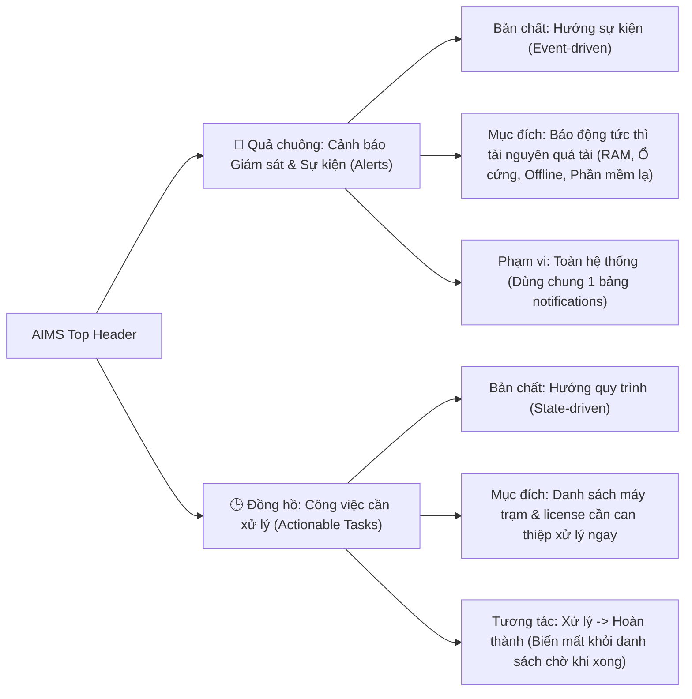
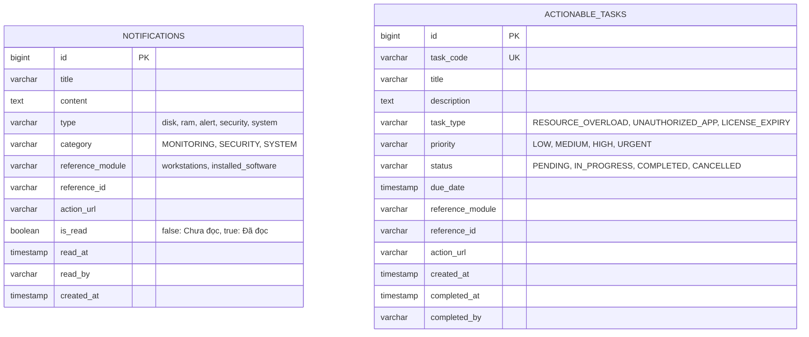

# ĐẶC TẢ YÊU CẦU NGHIỆP VỤ & CẤU TRÚC DATABASE BACKEND
## TÍNH NĂNG THÔNG BÁO (QUẢ CHUÔNG) & CÔNG VIỆC CẦN XỬ LÝ (ĐỒNG HỒ)
*Dự án: Hệ thống Quản trị Tài sản Doanh nghiệp - AIMS (Asset & IT Infrastructure Management System)*

---

## 1. TỔNG QUAN & ĐỊNH HƯỚNG DÙNG CHUNG TOÀN HỆ THỐNG

> [!IMPORTANT]
> **Định hướng cốt lõi theo yêu cầu**: 
> Toàn bộ thông báo, cảnh báo tài nguyên và danh sách công việc là **DÙNG CHUNG TOÀN HỆ THỐNG (GLOBAL / BROADCAST)**. 
> Không phân quyền theo từng `user_id` hay `role` riêng lẻ — Bất kỳ quản trị viên nào đăng nhập vào hệ thống đều thấy danh sách cảnh báo giống nhau để cùng theo dõi hạ tầng.



| Tiêu chí | 🔔 Quả chuông (Alerts & Notifications) | 🕒 Đồng hồ (Actionable Tasks / SLA) |
| :--- | :--- | :--- |
| **Bản chất** | **Event-driven (Cảnh báo sự kiện tức thời)** | **State-driven (Công việc cần can thiệp)** |
| **Phạm vi** | **Dùng chung toàn bộ quản trị viên** | **Dùng chung toàn bộ quản trị viên** |
| **Vòng đời** | Phát sinh khi vượt ngưỡng $\rightarrow$ Đọc/Xem $\rightarrow$ Lưu lịch sử. | Phát sinh khi có sự cố $\rightarrow$ Đang chờ IT xử lý $\rightarrow$ Bấm hoàn thành thì biến mất khỏi danh sách chờ. |
| **Nghiệp vụ thực tế** | - 🔴 *Ổ cứng C: máy WS-DESIGN-03 sắp đầy (chỉ còn 3.8 GB - 96%)*\n- 🔴 *RAM máy chủ SRV-01 vượt 95% liên tục 20 phút*\n- 🟠 *Phát hiện phần mềm chưa cấp phép (uTorrent)*\n- 🟠 *Máy trạm WS-ACC-05 mất tín hiệu Agent > 48h* | - 🔴 *5 Máy trạm quá tải tài nguyên (RAM/Ổ cứng) cần dọn dẹp*\n- 🟠 *3 Máy trạm có phần mềm lạ cần gỡ bỏ*\n- 🔵 *8 Giấy phép phần mềm sắp hết hạn (30 ngày)* |
| **Hành động người dùng** | Nhấp vào để xem chi tiết thông báo, nhảy tới máy trạm bị lỗi. | Nhấp vào để xử lý dọn dẹp ổ đĩa, gỡ phần mềm hoặc duyệt gia hạn bản quyền. |

---

## 2. ĐẶC TẢ NGHIỆP VỤ CHI TIẾT

### 2.1. Quả chuông - Cảnh báo giám sát & Thông báo (Notifications / Alerts)
1. **Cảnh báo dung lượng ổ cứng (Disk Space Alert)**:
   - Ổ C: dung lượng trống $\le$ 10% (hoặc $\le$ 5 GB) $\rightarrow$ Cảnh báo khẩn cấp `type = disk`.
2. **Cảnh báo bộ nhớ RAM (Memory Usage Alert)**:
   - Mức sử dụng RAM $\ge$ 90% kéo dài liên tục trên 15 phút $\rightarrow$ Cảnh báo `type = ram`.
3. **Cảnh báo trạng thái kết nối Agent (Agent Offline Alert)**:
   - Máy trạm không gửi dữ liệu Telemetry về hệ thống quá 24h hoặc 48h $\rightarrow$ Cảnh báo `type = alert`.
4. **Cảnh báo phần mềm chưa được cấp phép (Security Compliance Alert)**:
   - Phát hiện ứng dụng mới cài đặt ngoài danh mục cho phép $\rightarrow$ Cảnh báo `type = security`.
5. **Thông báo khôi phục (Recovery)**:
   - Khi tài nguyên hạ nhiệt về mức an toàn $\rightarrow$ Thông báo `type = system`.

### 2.2. Đồng hồ - Công việc cần xử lý (Actionable Tasks)
Danh sách các đầu việc đang chờ can thiệp trực tiếp:
1. **Máy trạm quá tải tài nguyên (Hôm nay / Đỏ)**: 5 máy vượt ngưỡng 90% RAM hoặc ổ C: dưới 10% $\rightarrow$ URL: `/giam-sat-may-tram`.
2. **Phần mềm lạ cần kiểm tra & gỡ bỏ (Gấp / Cam)**: 3 máy trạm có phần mềm lạ $\rightarrow$ URL: `/giam-sat-may-tram/phan-mem`.
3. **Giấy phép / License phần mềm sắp hết hạn (Đang chờ / Xanh)**: 8 license bản quyền dưới 30 ngày $\rightarrow$ URL: `/hop-dong-bao-hanh`.

---

## 3. THIẾT KẾ CƠ SỞ DỮ LIỆU TỐI GIẢN (DATABASE SCHEMA)

Vì **không phân chia theo User hay Role**, cơ sở dữ liệu được rút gọn tối đa: **Chỉ cần đúng 2 bảng độc lập, không cần bảng quan hệ phụ nhiều-nhiều!**



### 3.1. DDL Bảng Thông Báo & Cảnh Báo (Notifications)

```sql
-- Bảng duy nhất lưu trữ toàn bộ thông báo hệ thống (Dùng chung cho mọi Admin)
CREATE TABLE notifications (
    id BIGSERIAL PRIMARY KEY,
    title VARCHAR(255) NOT NULL,
    content TEXT NOT NULL,
    type VARCHAR(30) NOT NULL DEFAULT 'alert',      -- 'disk', 'ram', 'alert', 'security', 'system'
    category VARCHAR(50) NOT NULL DEFAULT 'MONITORING', -- 'MONITORING', 'SECURITY', 'SYSTEM'
    reference_module VARCHAR(50),                   -- 'workstations', 'installed_software', 'contracts'
    reference_id VARCHAR(100),                      -- ID bản ghi liên quan (vd: workstation_id)
    action_url VARCHAR(255),                        -- URL frontend (vd: /giam-sat-may-tram)
    
    is_read BOOLEAN NOT NULL DEFAULT FALSE,         -- Trạng thái đọc chung
    read_at TIMESTAMP WITH TIME ZONE,               -- Thời điểm bấm đọc
    read_by VARCHAR(100),                           -- Tên người dùng bấm đọc
    
    created_at TIMESTAMP WITH TIME ZONE DEFAULT CURRENT_TIMESTAMP
);

-- Index tối ưu tốc độ đếm số unread và load danh sách mới nhất
CREATE INDEX idx_notifications_unread ON notifications(is_read, created_at DESC);
CREATE INDEX idx_notifications_type ON notifications(type);
```

### 3.2. DDL Bảng Công Việc Chờ Xử Lý (Actionable Tasks)

```sql
-- Bảng lưu trữ công việc đang chờ xử lý (Dùng chung cho toàn bộ kỹ thuật viên IT)
CREATE TABLE actionable_tasks (
    id BIGSERIAL PRIMARY KEY,
    task_code VARCHAR(50) UNIQUE NOT NULL,          -- Mã: 'TSK-2026-0001'
    title VARCHAR(255) NOT NULL,                    -- Tiêu đề: 'Xử lý ổ đĩa C: sắp đầy máy WS-DESIGN-03'
    description TEXT,                               -- Chi tiết vấn đề cần IT can thiệp
    task_type VARCHAR(50) NOT NULL,                 -- 'RESOURCE_OVERLOAD', 'UNAUTHORIZED_APP', 'LICENSE_EXPIRY'
    priority VARCHAR(20) NOT NULL DEFAULT 'MEDIUM', -- 'LOW', 'MEDIUM', 'HIGH', 'URGENT'
    status VARCHAR(30) NOT NULL DEFAULT 'PENDING',  -- 'PENDING', 'IN_PROGRESS', 'COMPLETED', 'CANCELLED'
    due_date TIMESTAMP WITH TIME ZONE NOT NULL,     -- Deadline xử lý
    
    reference_module VARCHAR(50),                   -- 'workstations', 'installed_software'
    reference_id VARCHAR(100),
    action_url VARCHAR(255),                        -- URL dẫn thẳng đến trang xử lý
    
    created_at TIMESTAMP WITH TIME ZONE DEFAULT CURRENT_TIMESTAMP,
    updated_at TIMESTAMP WITH TIME ZONE DEFAULT CURRENT_TIMESTAMP,
    completed_at TIMESTAMP WITH TIME ZONE,          -- Thời điểm hoàn thành
    completed_by VARCHAR(100)                       -- Tên tài khoản bấm hoàn tất
);

CREATE INDEX idx_tasks_pending ON actionable_tasks(status, due_date ASC) 
WHERE status IN ('PENDING', 'IN_PROGRESS');
```

---

## 4. ĐẶC TẢ DANH SÁCH RESTful API CẦN CUNG CẤP

### 4.1. Nhóm API Quả Chuông (Notifications)

#### 1. Lấy số lượng thông báo chưa đọc
- **Endpoint**: `GET /api/v1/notifications/unread-count`
- **SQL Backend**: `SELECT COUNT(*) FROM notifications WHERE is_read = false;`
- **Response**:
```json
{
  "isSuccess": true,
  "data": {
    "unreadCount": 3
  }
}
```

#### 2. Lấy danh sách thông báo (Phân trang & Lọc)
- **Endpoint**: `GET /api/v1/notifications`
- **Query Params**: `page=1&pageSize=10&filter=all|unread|alert`
- **Response**:
```json
{
  "isSuccess": true,
  "data": {
    "totalCount": 18,
    "unreadCount": 3,
    "items": [
      {
        "id": 101,
        "title": "Cảnh báo ổ cứng sắp đầy (96%)",
        "content": "Máy trạm [WS-DESIGN-03] - Ổ C: chỉ còn 3.8 GB trống / 128 GB. Cần dọn dẹp gấp để tránh treo máy.",
        "type": "disk",
        "category": "MONITORING",
        "actionUrl": "/giam-sat-may-tram",
        "isRead": false,
        "createdAt": "2026-11-21T08:15:00Z"
      },
      {
        "id": 102,
        "title": "Cảnh báo RAM quá tải (>90%)",
        "content": "Máy chủ [SRV-APP-PROD] sử dụng 15.2 / 16 GB RAM (95%) duy trì liên tục trên 20 phút.",
        "type": "ram",
        "category": "MONITORING",
        "actionUrl": "/giam-sat-may-tram",
        "isRead": false,
        "createdAt": "2026-11-21T08:00:00Z"
      },
      {
        "id": 103,
        "title": "Phát hiện phần mềm chưa cấp phép",
        "content": "Máy trạm [WS-DEV-09] vừa cài đặt phần mềm lạ (uTorrent Client) không thuộc danh mục cho phép.",
        "type": "security",
        "category": "SECURITY",
        "actionUrl": "/giam-sat-may-tram/phan-mem",
        "isRead": false,
        "createdAt": "2026-11-21T07:30:00Z"
      }
    ]
  }
}
```

#### 3. Đánh dấu đã đọc một thông báo
- **Endpoint**: `PUT /api/v1/notifications/{id}/read`
- **SQL Backend**: `UPDATE notifications SET is_read = true, read_at = NOW(), read_by = @userName WHERE id = @id;`
- **Response**: `{"isSuccess": true, "message": "Đã đánh dấu thông báo là đã đọc."}`

#### 4. Đánh dấu tất cả thông báo là đã đọc
- **Endpoint**: `PUT /api/v1/notifications/read-all`
- **SQL Backend**: `UPDATE notifications SET is_read = true, read_at = NOW(), read_by = @userName WHERE is_read = false;`
- **Response**: `{"isSuccess": true, "message": "Tất cả thông báo đã được đánh dấu đã đọc."}`

---

### 4.2. Nhóm API Đồng Hồ (Pending Tasks & SLA)

#### 1. Lấy dữ liệu tóm tắt công việc chờ xử lý (Dropdown Summary)
- **Endpoint**: `GET /api/v1/tasks/summary`
- **Response**:
```json
{
  "isSuccess": true,
  "data": {
    "totalPendingCount": 16,
    "groups": [
      {
        "groupKey": "RESOURCE_OVERLOAD",
        "title": "Máy trạm quá tải tài nguyên (RAM/Ổ cứng)",
        "count": 5,
        "urgency": "TODAY",
        "urgencyLabel": "Hôm nay",
        "badgeColor": "red",
        "targetUrl": "/giam-sat-may-tram"
      },
      {
        "groupKey": "UNAUTHORIZED_APP",
        "title": "Phần mềm lạ cần kiểm tra & gỡ bỏ",
        "count": 3,
        "urgency": "URGENT",
        "urgencyLabel": "Gấp",
        "badgeColor": "orange",
        "targetUrl": "/giam-sat-may-tram/phan-mem"
      },
      {
        "groupKey": "LICENSE_EXPIRING",
        "title": "Giấy phép / License sắp hết hạn (30 ngày)",
        "count": 8,
        "urgency": "PENDING",
        "urgencyLabel": "Đang chờ",
        "badgeColor": "blue",
        "targetUrl": "/hop-dong-bao-hanh"
      }
    ]
  }
}
```

#### 2. Cập nhật tiến độ / Hoàn tất công việc
- **Endpoint**: `PUT /api/v1/tasks/{id}/complete`
- **SQL Backend**: `UPDATE actionable_tasks SET status = 'COMPLETED', completed_at = NOW(), completed_by = @userName WHERE id = @id;`
- **Response**: `{"isSuccess": true, "message": "Công việc đã được hoàn thành thành công."}`

---

## 5. CƠ CHẾ CRONJOB TỰ ĐỘNG CỦA BACKEND

Backend chỉ cần viết 3 worker đơn giản:

| Tên Job | Tần suất | Điều kiện quét Telemetry | Hành động sinh ra |
| :--- | :--- | :--- | :--- |
| **`TelemetryThresholdMonitorJob`** | Mỗi **5 phút** | Ổ đĩa C: còn $< 10\%$ dung lượng HOẶC RAM $> 90\%$ liên tục 15 phút | `INSERT` 1 dòng vào `notifications` (loại `disk`/`ram`) + `INSERT` vào `actionable_tasks`. |
| **`AgentOfflineDetectorJob`** | Mỗi **15 phút** | Không nhận được heartbeat telemetry từ máy trạm quá 24h hoặc 48h | `INSERT` 1 dòng vào `notifications` (loại `alert`). |
| **`SoftwareAuditJob`** | Khi Agent gửi danh sách app mới | Ứng dụng mới cài đặt không nằm trong whitelist cho phép | `INSERT` 1 dòng vào `notifications` (loại `security`) + `INSERT` vào `actionable_tasks`. |
